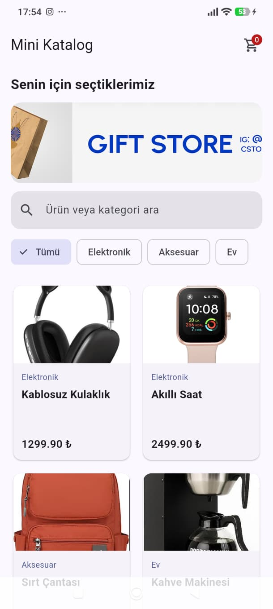
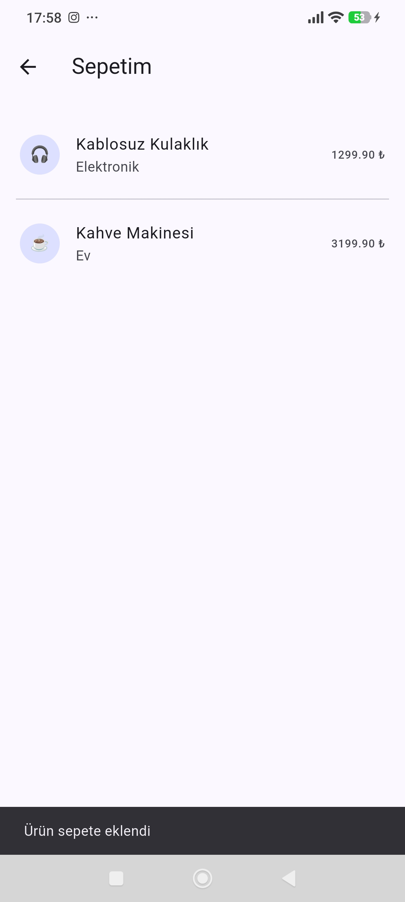

# Mini Katalog

Flutter ile geliştirilmiş, ürünleri listeleyen ve ürün detaylarını gösteren basit bir mobil katalog uygulaması.

## Özellikler

- JSON dosyasından ürün verisi yükleme
- Ürünleri kategoriye göre filtreleme ve arama
- Grid görünümünde ürün kartları
- Ürün detay sayfası
- Sepete ürün ekleme ve toplam tutarı görüntüleme
- Yerel görsel varlıkları kullanma

## Kullanılan araçlar

- Flutter 3.50.0
- Dart 3.14.0
- Android cihaz

## Çalıştırma

```bash
flutter pub get
flutter run

## Ekran görüntüleri

### Ana ekran


### Ürün detayı


### Sepet
